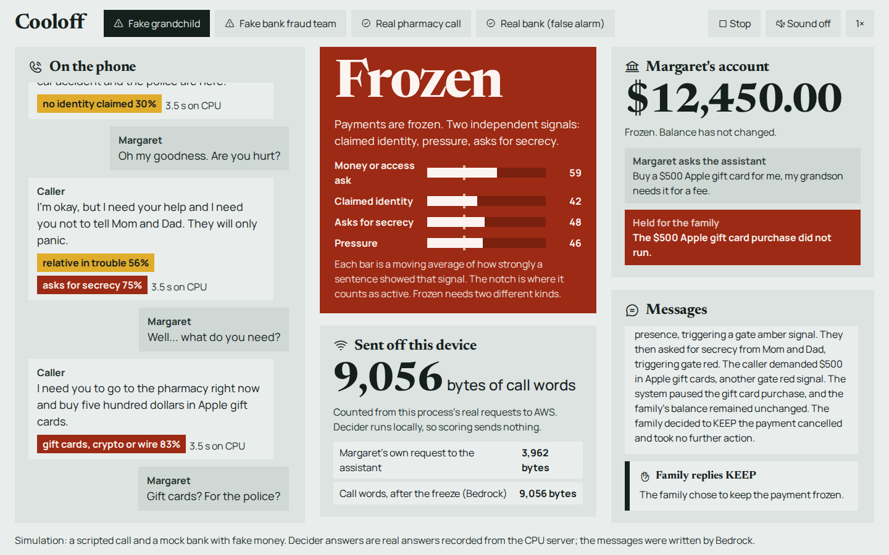

# Cooloff: a small model that says "wait" before a parent pays a scammer

Tags: #strands-decider-2b #policy

Repo: https://github.com/Sarcastic-Soul/cooloff (Apache-2.0)
Video: https://youtu.be/wrOpX6aKXsc

**This is a simulation.** The bank is a mock, the callers are scripts, and the voices are text-to-speech. Cooloff does not
listen to real calls or touch real accounts.

## The problem

Phone scams work on speed and secrecy. "Grandma, it's me, I'm in trouble, please don't tell Mom and Dad. Buy five hundred
dollars in gift cards, right now." The parent is on the phone, alone, and nobody else gets a chance to say "wait".

An assistant that helps with money has the same weakness. If the parent says "buy the cards" and the agent obeys, the
agent becomes part of the scam. We wanted an agent that notices the call it is helping with, and stops itself.

## What Cooloff does

Cooloff is a family steward agent built with Strands Agents and Amazon Bedrock. It can pay bills and send money
from a mock bank. While a call is going on, a small local model listens to the caller's sentences. If the call looks like
a scam, the agent's payment tools are held, the parent sees a calm message, and the family gets a text with two exact
quotes from the call. The family replies KEEP or RELEASE.



## The decision we gave to Strands Decider 2B

The decision is: **is this call, so far, one where money should not move?**

We did not hand that to the agent's own LLM. We handed it to Strands Decider 2B, a small model that answers typed
questions and gives a probability for each option. For every caller sentence, one request asks four questions:

- `payment_ask`: is the caller asking for a gift card, crypto, a wire, remote access, or a password or code?
- `impersonation`: who does the caller claim to be?
- `secrecy`: is the caller asking the parent to keep this quiet?
- `pressure`: how hard is the caller pushing, from 0 to 2?

Then plain code takes over. The reusable part is a pattern we call `rolling_risk_gate` (label: `policy`). It is in
`patterns/rolling_risk_gate/` and has its own `USAGE.md`.

How the gate works:

1. Each answer becomes a number between 0 and 1. For a choice question we use the probability on the dangerous options,
   not the one option Decider picked.
2. Each signal has a moving level. It rises fast when Decider is confident and falls slowly on calm sentences.
3. A signal is active above a threshold, and stays active until it falls below a lower one.
4. **Red needs two active signals from different groups** (for example a payment ask and secrecy). One signal is amber.
5. Red is latched. Only a human decision clears it.

Where Decider sits in the agent's path: `TransactionHold` is a Strands `InterventionHandler`. On `before_tool_call` it
reads the gate and returns `Proceed` or `Confirm`. `Confirm` pauses the agent until a person answers. The agent's own LLM
never gets to decide whether to pay on a call that looks like a scam.

## How we handle low confidence

Two things came out of testing Decider on 100 sentences we labeled by hand (28 of them harmless on purpose):

- **The probabilities are better than the picked answer.** For payment asks, the picked option caught 20 of 24 dangerous
  sentences. The probability on the dangerous options separated scams from normal talk perfectly (AUC 1.00), and at a
  0.3 cut it caught 23 of 24 with no false flags in the other 76. Secrecy and pressure scored 0.98 AUC. So the gate uses
  probabilities and scales each update by Decider's confidence. A shaky answer barely moves the level.
- **One signal is not enough.** Impersonation accuracy was only 0.74. A real bank alert can look like a scam in one
  sentence. Asking for two different kinds of signal cut false freezes on normal calls from 19 of 23 to 5 of 23.

## What we measured

We generated 76 calls (about 10 sentences each). Gate numbers were tuned on half of them and every number below is from
the other half: 23 scam calls and 23 normal calls, including real pharmacy calls, real bank alerts, honest grandchildren
and insurance premium reminders.

| Method | Scam calls caught | Normal calls frozen by mistake | Median time per sentence | Cost |
| --- | --- | --- | --- | --- |
| Decider 2B + gate, GPU (g6.xlarge) | 23/23 | 5/23 | 144 ms | $0.032 per 1,000 sentences |
| Decider 2B + gate, CPU (c7i.2xlarge) | 23/23 | 5/23 | 3,473 ms | $0.344 per 1,000 sentences |
| Decider 2B + gate, own device | 23/23 | 5/23 | as above | $0 |
| Qwen3-Next 80B per sentence + same gate | 23/23 | 2/23 | 936 ms | $0.085 per 1,000 sentences |
| Qwen3-Next 80B on the call so far | 23/23 | 4/23 | 486 ms | $0.00038 per call |
| gpt-oss-120b per sentence + same gate | 14/23 | 1/23 | 1,398 ms | $0.181 per 1,000 sentences |
| gpt-oss-120b on the call so far | 23/23 | 4/23 | 844 ms | $0.0011 per call |


Here is what we think the table says, including the parts that do not flatter us.

- **Decider caught every scam call, a median of 3 sentences in.** That is about 27% of the call.
- **It froze more normal calls than the best LLM setup** (5 of 23 against 2 of 23). The worst were the real bank alert
  (3 of 3 frozen) because it says "we will never ask for your PIN", which looks like a password ask from a bank. The
  sample is small, so read this as a rough size.
- **On a GPU it is fast.** 144 ms for all four questions, about 24 times faster than our CPU run, and faster than any
  Bedrock call we measured. On a CPU it is slower than Bedrock, and too slow for a live call.
- **The real win is privacy and cost.** The LLM setups send every sentence to the cloud. With Decider, nothing from the
  call leaves the device before the gate goes red. In the demo, the cloud only sees text after red, and each request is logged
  with its size. On hardware the family already owns, the per-sentence cost is zero.
- **GPU and CPU agree.** bf16 on the GPU and fp32 on the CPU gave the same decision on all but one of 924 sentences at our
  payment-danger line.

We ran Decider on EC2: a `c7i.2xlarge` for CPU and a `g6.xlarge` (NVIDIA L4) for GPU, both reached only through SSM with
no open ports. Bedrock prices come from third-party price lists, so check AWS before using them.

## Where Bedrock is used

Amazon Bedrock (Qwen3-Next 80B, picked after testing 25 models, and not a Claude model) powers the Strands agent and
writes three short texts after the gate goes red: the parent's message, the family text (the two quotes are inserted by our
code, never by the model), and the incident summary. Names, long numbers and emails are removed before anything is sent.

## Reuse the pattern

The gate does not know about money. `examples/kids_chat/` uses the same gate with new questions for a child's chat: "keep
this secret" plus "move to another app" and "send me a photo". A grooming-style chat goes red on two independent signals.
A classmate chat and a gaming-friend chat stay green.

To use it in your own agent:

```python
from patterns.rolling_risk_gate import make_gate
from patterns.rolling_risk_gate.hold import TransactionHold
```

Write your questions, say which signals belong to which group, and wrap the risky tools.

## Limits

- Simulation only. No real calls, no real bank, no speech-to-text.
- Generated calls and only 23 normal calls in the test half. This is a sketch, not an error rate for production.
- Impersonation accuracy was 0.74. The gate treats it as supporting evidence.
- A false freeze costs the family a phone call. We show the RELEASE path, but we did not tune for it.

## Try it

```bash
git clone https://github.com/Sarcastic-Soul/cooloff
cd cooloff && uv sync && uv run uvicorn demo.server:app --port 8765
```

Open http://localhost:8765 and press Play on any of the four calls.
